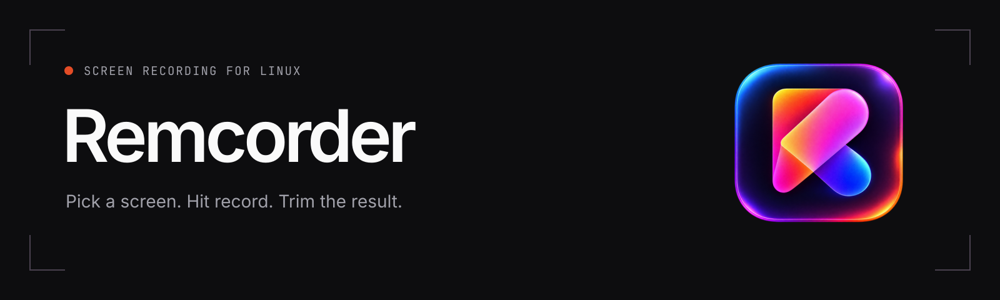
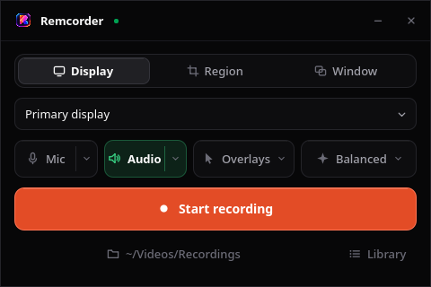

<p align="center">
  
</p>

<p align="center">
  <a href="https://github.com/remcostoeten/remcorder/releases">Downloads</a> ·
  <a href="docs/usage.md">User guide</a> ·
  <a href="https://github.com/remcostoeten/remcorder/issues">Report a bug</a>
</p>

Remcorder is a Linux screen recorder with a small Qt window, tray controls, and a
CLI for keyboard shortcuts. It uses **gpu-screen-recorder** for capture and saves
recordings locally. Pick a screen or region, hit record, then trim the result.

Recording runs in a separate background service, so closing the window won't
stop your capture. The app, tray, and CLI all control the same recording.

<p align="center">
  
</p>

## What it does

- Record a monitor, a selected region, or a window through the desktop portal.
- Capture desktop audio and your microphone, with a live input meter and gain control.
- Pause and resume from the app, tray, recording pill, or a keyboard shortcut.
- Show keystrokes, draw on screen, or add a floating webcam bubble for walkthroughs.
- Rename a finished recording or open its folder.
- Trim any video into a separate copy. Drop a file on the window, pick one with
  **Edit video**, or use **Open with** in your file manager.
- Lower the volume or mute the copy, with the audio waveform shown under the preview.
- Set frame rate, codec, quality, a start delay, and sound cues.

Some overlays need compositor support or input permissions. See the
[compatibility notes](#compatibility) before enabling them.

## Install

### Arch Linux

Download the `.pkg.tar.zst` from [Releases](https://github.com/remcostoeten/remcorder/releases),
then run this from the directory containing the downloaded package:

```sh
sudo pacman -U ./remcorder-*.pkg.tar.zst
systemctl --user enable --now remcorder.service
remcorder
```

The package includes the app, daemon, CLI, and desktop entry. Install `ffmpeg`
for trimming and `libpulse` for the microphone controls. If there isn't a package
for the version you want yet, build from source below.

### From source

You'll need a C++20 compiler, CMake, Go (see [go.mod](go.mod)), Qt 6.8 or newer,
and the `gpu-screen-recorder` executable on your `PATH`. The prerequisite script
supports Arch, Debian 13+, Ubuntu 25.04+, Fedora, and openSUSE and their
derivatives. It shows what it will install, asks before using `sudo`, then checks
every tool and version. Pass `--yes` to skip the prompts, or `--check` to only
check. Review [the package list](scripts/packages.conf) first if you'd rather
install them yourself.

```sh
git clone https://github.com/remcostoeten/remcorder.git
cd remcorder
./scripts/pre-reqs.sh
make install
systemctl --user enable --now remcorder.service
remcorder
```

`make install` runs the project checks and installs to `~/.local`. Add
`~/.local/bin` to your `PATH` if your shell doesn't already include it.
On Fedora the script offers a COPR for `gpu-screen-recorder`. On Debian and
Ubuntu you'll need to [build it yourself](https://git.dec05eba.com/gpu-screen-recorder/about/).
Remcorder needs its command-line executable, not just a Flatpak app.

## Your first recording

1. Choose a monitor, **Region**, or portal capture in the app.
2. Set desktop audio and microphone input, then press the record button.
3. Stop from the floating pill or tray. Open, rename, or trim the saved file.

Files go into `Recordings` inside your XDG Videos directory by default.
Trim exports create a new file and keep the original.

To start the app in the tray, use `remcorder --tray`. From a source checkout,
`make tray` also installs it and sets up tray autostart.

## Keyboard shortcuts and scripts

Bind these commands in your desktop or compositor settings:

```sh
remcorderctl toggle
remcorderctl toggle-pause
```

For example, in Hyprland:

```ini
bind = SUPER SHIFT, R, exec, remcorderctl toggle
bind = SUPER SHIFT, P, exec, remcorderctl toggle-pause
```

Other useful commands:

```sh
remcorderctl --delay 3s start
remcorderctl --open-dir stop
remcorderctl --json status
remcorder --trim /path/to/video.mp4
```

CLI options go **before** the command. The [user guide](docs/usage.md) covers
all commands, overlays, audio, and daemon settings.

## Compatibility

Remcorder targets Linux with a systemd user session. Capture and codec support
depend on your GPU, drivers, desktop session, and `gpu-screen-recorder`.

| Feature | Requirements and limits |
| --- | --- |
| Portal capture | A working desktop screencast portal |
| Overlays on Wayland | LayerShellQt and a compositor with layer-shell support; GNOME falls back to ordinary windows |
| Keystrokes and annotation pen | Read access to keyboard devices under `/dev/input`; see the [setup instructions](docs/usage.md#keystroke-overlay) |
| Keystroke labels | Currently assume a US keyboard layout |
| Click highlights | KDE Plasma's KWin mouse click effect |
| Trim export and waveform | `ffmpeg`; motion blur is experimental |
| Microphone controls | `pactl` through PipeWire's PulseAudio compatibility layer or PulseAudio |

The keystroke overlay shows input from any application, including passwords.
Pause or stop recording before entering anything private. The annotation pen
also monitors input while enabled in the running app.

The native app includes its own recording overlays. Enable
`remcorder-overlay.service` only when you want the standalone overlay for CLI
use; running both can show duplicates.

## Development

```sh
make check
```

This runs Go tests, `go vet`, the Qt release build, and QML lint checks.
See [CONTRIBUTING.md](CONTRIBUTING.md) for the source layout and development setup.
Release instructions and artwork are in [docs/releasing.md](docs/releasing.md).

## Credits and license

Capture is handled by [gpu-screen-recorder](https://git.dec05eba.com/gpu-screen-recorder/about/).
The interface uses Qt 6; the daemon and CLI are written in Go.

Remcorder is [MIT licensed](LICENSE).
